<a href="https://fishsticks53.github.io/Portfolio/" title="About me · opens my portfolio"><picture><source media="(prefers-color-scheme: dark)" srcset="./assets/about-dark.svg"></picture></a>
<a href="https://github.com/Fishsticks53" title="Activity · opens my GitHub contribution graph"><picture><source media="(prefers-color-scheme: dark)" srcset="./assets/activity-dark.svg"></picture></a>
<a href="https://github.com/Fishsticks53?tab=repositories" title="Tech stack · opens my repositories"><picture><source media="(prefers-color-scheme: dark)" srcset="./assets/stack-dark.svg"></picture></a>
<a href="https://fishsticks53.github.io/Portfolio/" title="Portfolio · opens my portfolio"><picture><source media="(prefers-color-scheme: dark)" srcset="./assets/portfolio-dark.svg"></picture></a>
