  <picture>
    <source media="(prefers-color-scheme: dark)" srcset="./assets/banner-dark.svg">
    
  </picture>

Full-stack developer building AI-enabled systems with agentic architectures.

<a href="https://fishsticks53.github.io/Portfolio/"><b>Visit my portfolio →</b></a>

  <picture>
    <source media="(prefers-color-scheme: dark)" srcset="./assets/divider-dark.svg">
    
  </picture>

## Stack

<picture>
  <source media="(prefers-color-scheme: dark)" srcset="./assets/stack-dark.svg">
  
</picture>

## Now

<picture>
  <source media="(prefers-color-scheme: dark)" srcset="./assets/now-dark.svg">
  
</picture>

## Contributions

<picture>
  <source media="(prefers-color-scheme: dark)" srcset="./assets/city-dark.svg">
  
</picture>

  <picture>
    <source media="(prefers-color-scheme: dark)" srcset="./assets/divider-dark.svg">
    
  </picture>

